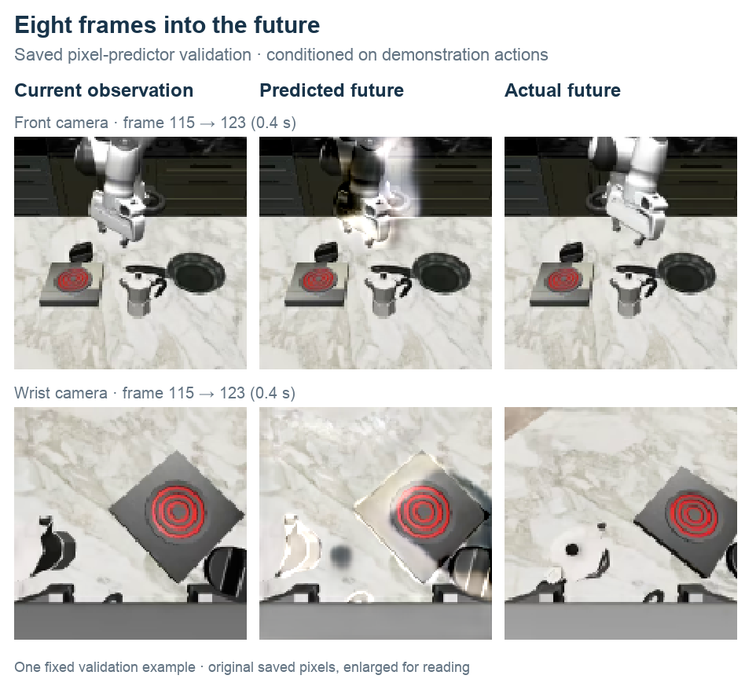
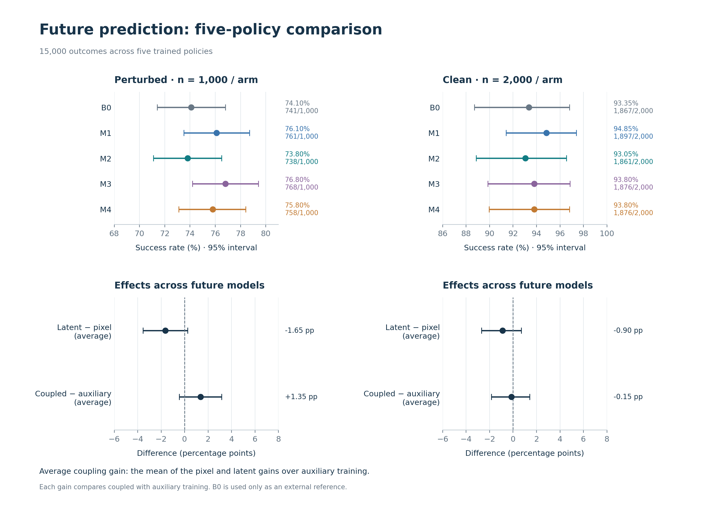
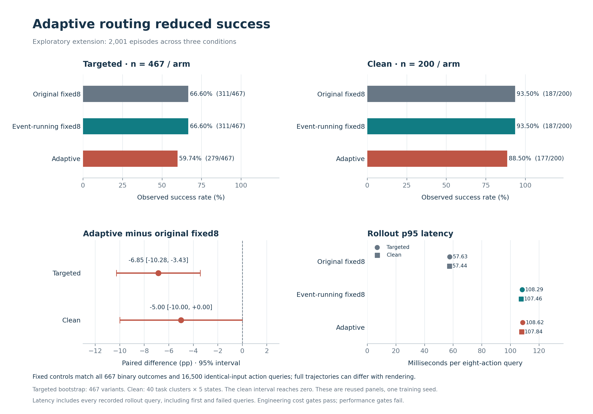
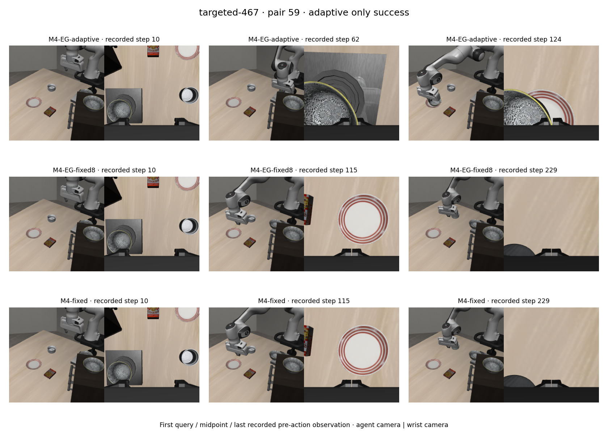
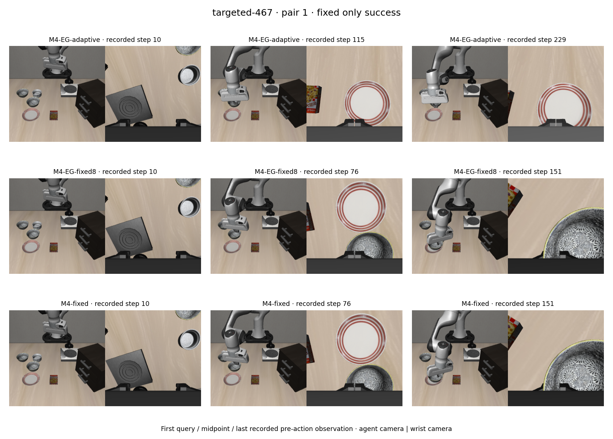

A robot moving a bowl onto a plate has to align its gripper, establish contact, keep hold of the bowl, and place it. I wanted to test whether predicting parts of that near future could help a robot policy make better decisions, especially when the camera view or starting position changes.

I built pixel and latent future predictors and connected them to a vision-language-action policy. The main experiment compared five policies to separate the value of learning to predict the future from the value of using that prediction to refine an action.

There were encouraging gains on perturbed tasks. **The pixel-coupled policy completed 76.8% of cases, compared with 74.1% for the action-only baseline.** The gains varied across designs, and the experiment leaves uncertainty about the extra benefit of coupling over auxiliary training. This post follows how I built the system, what the comparisons showed, and what happened when event timing chose the prediction horizon.

## How the policy uses a predicted future

A vision-language-action policy turns camera observations and a language instruction into robot actions. My implementation uses a Qwen3.5-2B backbone, front and wrist cameras, and the robot's current state. Its action head follows the continuous-action, chunked approach described in the [Optimized Fine-Tuning work](https://arxiv.org/abs/2502.19645): each query produces eight actions, which the simulator executes before the policy observes again.

The experiments use simulated manipulation tasks from LIBERO and [LIBERO-Plus](https://github.com/sylvestf/LIBERO-plus). LIBERO-Plus adds changes such as camera viewpoints, robot starting states, lighting, and object layouts. I evaluated defined subsets of those tasks; the numbers below are not a full-benchmark leaderboard result.

I built two kinds of future predictor. The **pixel predictor** learns to reconstruct future front and wrist images. The **latent predictor**, using a joint-embedding predictive architecture, learns to predict visual features extracted from future images. Both condition on the current scene, instruction, robot state, an action sequence, and a requested prediction horizon.

I then connected these predictors to the policy in two ways:

- **Auxiliary training:** future prediction adds a training objective to the action objective. The future branch is removed at deployment.
- **Coupled action generation:** the policy proposes eight actions, a future module predicts representations conditioned on that proposal, and an attention block feeds those representations back into the action head for one refinement.

That second path is a single proposal-and-refinement pass. It does not search over a tree of imagined trajectories. Even in the pixel-trained version, the action head consumes internal future tokens; it does not inspect a rendered future image. Ground-truth future observations are training targets and never enter the deployed action path.

*Five policies share the same backbone design. B0 learns actions alone. M1/M2 add pixel/latent prediction during training, then remove the future branch. M3/M4 retain a future core and use its tokens for one action refinement. Dashed elements are training-only; all policies execute eight actions per query. Pixel and latent refer to the prediction targets used in training.*

### What a predicted future looks like

Here is a saved example of the pixel-prediction objective. Given the current observations and recorded demonstration actions, the model predicts both camera views **eight frames (0.4 seconds) ahead**.

*One example from the fixed validation panel, using the pretrained pixel module before downstream policy training. Both rows use the same observation time. The images preserve scene appearance but show blur around moving gripper edges. Recorded demonstration actions supply the conditioning in this reconstruction check.*

This setup let me distinguish two questions: whether learning to predict the future helps the policy's representations, and whether explicitly using a predicted future during action generation adds value.

## What the five-policy comparison showed

I compared five policies: an action-only baseline, pixel and latent auxiliary policies, and pixel and latent coupled policies. Each received the same ordered action-training examples and two action-training epochs, starting from matched shared policy initialization. The coupled policies were trained independently, rather than continued from the trained auxiliary policies.

Each arm was evaluated on **1,000 perturbed cases and 2,000 clean episodes**. Matching action exposure made the comparison more informative, but it did not equalize total computation: future pretraining, added parameters, inference work, and tuning costs still differed.

| Policy | Perturbed success | Clean success | Query latency (ms) |
| :--- | ---: | ---: | ---: |
| B0 · Action-only | 74.10% (741/1,000) | 93.35% (1,867/2,000) | 43.28 / 44.67 |
| M1 · Pixel auxiliary | 76.10% (761/1,000) | **94.85%** (1,897/2,000) | 43.58 / 44.98 |
| M2 · Latent auxiliary | 73.80% (738/1,000) | 93.05% (1,861/2,000) | 43.49 / 44.80 |
| M3 · Pixel coupled | **76.80%** (768/1,000) | 93.80% (1,876/2,000) | 46.68 / 48.08 |
| M4 · Latent coupled | 75.80% (758/1,000) | 93.80% (1,876/2,000) | 47.37 / 48.82 |

*Success rates include successful runs / total; bold marks the highest observed rate in each panel. Latency is median / 95th percentile per complete eight-action query on the perturbed panel. All five policies ran on the same RTX 5090, with first and failed queries included.*

*Error bars and reported ranges show 95% confidence intervals: the 2.5th and 97.5th percentiles of 10,000 bootstrap resamples. Perturbed resamples draw task variants; clean resamples draw 40 task clusters, keeping all 50 states in each cluster together. Each draw uses the same sampled cases across policies, preserving the pairing for differences. These intervals measure evaluation-sample uncertainty for the trained models.*

On the perturbed panel, pixel auxiliary training reached **76.1%**, pixel coupling **76.8%**, and latent coupling **75.8%**, compared with the action-only baseline's **74.1%**. Latent auxiliary training reached **73.8%**. Three of the four future-trained policies therefore had higher observed success than the baseline on this panel; the improvement was not uniform across designs.

The largest observed gain was the pixel-coupled policy's **+2.70 percentage points** over the baseline, with an interval of **+0.10 to +5.30**.

The comparison with auxiliary training asks how much the deployed future path adds. The pixel auxiliary policy already reached 76.1%, so coupling added **+0.70 points** (**−1.90 to +3.30**). For latent prediction, the corresponding gain was **+2.00 points** (**−0.50 to +4.50**).

The **average coupling gain** was **+1.35 points** (**−0.45 to +3.15**), averaging the pixel and latent gains. The chart also compares latent with pixel prediction, averaged across auxiliary and coupled policies. Both comparisons use the four future-trained models; the action-only baseline is a separate reference.

On clean tasks, the average coupling gain was **−0.15 points** (**−1.85 to +1.43**), compared with **+1.35 points** on the perturbed panel.

For me, the useful outcome is a concrete direction to investigate: **future-trained policies produced some encouraging gains under perturbation, with the strongest observed result in the pixel-coupled design.** Establishing how much of that gain comes from the auxiliary objective, the deployed future information, or the additional model capacity needs further controlled evidence.

### What does looking ahead cost?

Auxiliary training leaves little inference overhead: both policies remove the future branch at deployment and stayed within **1% of B0's median query latency**. Pixel coupling took **46.68 ms versus 43.28 ms** for B0—**3.40 ms, or about 8%, more**. Latent coupling took **47.37 ms**, about **9% more**.

These measurements cover generating an eight-action chunk, not the time to execute it or complete a task. In the separate event-timing evaluation below, running the additional predictor nearly doubled median query latency (**52.95 → 103.62 ms**), a substantially larger deployment cost.

### Three policies on the same task

In this selected case, the robot must move the black bowl from the center of the table onto the plate, starting from a perturbed robot state. **M3 completes the task; B0 and M1 fail.** Including M1 makes the distinction between auxiliary training and deployed coupling visible in the same comparison.

<video controls muted playsinline preload="metadata" poster="/assets/images/eventground-wam/five-policy-gain-poster.png?v=d5af1b1f9ad1" style="width:100%;height:auto;display:block" aria-label="Recorded comparison of B0, M1, and M3 on bowl placement: M3 succeeds; B0 and M1 fail.">
  <source src="/assets/videos/eventground-wam/five-policy-gain.mp4?v=aa8d4c0519d5" type="video/mp4">
  <a href="/assets/videos/eventground-wam/five-policy-gain.mp4?v=aa8d4c0519d5">Watch the three-policy comparison.</a>
</video>

*Case 0035: the first M3-only success against B0/M1 with exactly matching recorded starting inputs. Playback aligns control steps at 20 Hz; it omits inference wall time. Each shorter recording holds its last pre-action frame with an explicit label. Outcomes come from the episode records.*

See a case where B0 and M1 succeed but M3 fails

A different starting state reverses the outcome on the same bowl-placement task: **B0 and M1 succeed; M3 fails**. This is why the aggregate comparison matters alongside an individual demonstration.

<video controls muted playsinline preload="none" poster="/assets/images/eventground-wam/five-policy-regression-poster.png?v=db5601cc7a54" style="width:100%;height:auto;display:block" aria-label="Recorded comparison of B0, M1, and M3 on bowl placement: B0 and M1 succeed; M3 fails.">
  <source src="/assets/videos/eventground-wam/five-policy-regression.mp4?v=d9e368ebe30a" type="video/mp4">
  <a href="/assets/videos/eventground-wam/five-policy-regression.mp4?v=d9e368ebe30a">Watch the comparison with the opposite outcome.</a>
</video>

*Case 0034: the first opposite-outcome case with exactly matching recorded starting inputs. The same playback and frame-holding rules apply. Both clips are selected examples, not estimates of how often coupling helps.*

## Can event timing choose a better prediction horizon?

The five-policy comparison tested ways to learn from and use predicted futures. Both coupled policies looked **eight control frames ahead**. That leaves a different question: **would a future near the next contact or grasp be more useful than one at a fixed distance?** A robot approaching a bowl and a robot already holding it may need information about different moments. I tested this idea as an add-on to M4, the latent-coupled policy.

### How the horizon changes

I trained a separate event predictor on automatically labeled demonstrations. From the current camera images, instruction, and robot state, it predicts the **next new contact, grasp, or gripper closure within 32 frames**, including when that event will begin. It can also predict that no new event will occur in that window.

At each action query, the controller:

1. **Predicts the next event and its timing.** The predictor has no access to future observations during execution.
2. **Chooses the closest supported horizon:** 2, 4, 8, 16, or 32 frames. For example, contact predicted 14 frames away selects 16. Ties go to the shorter horizon; no predicted new event selects eight.
3. **Uses that horizon in M4's future module**, then refines and executes the usual eight-action proposal.

*The added branch chooses when to predict. The original action weights stay fixed, and execution remains eight actions per query. The 14-frame example illustrates the mapping rule.*

A longer horizon therefore asks for a more distant prediction without supplying a longer action plan. Beyond the eight proposed actions, the future module receives padded conditioning.

### Experiment setup

I ran three versions of the same M4 policy:

- **Fixed horizon:** the original policy, always looking eight frames ahead.
- **Event predictor + fixed horizon:** run the event predictor, but keep the horizon at eight. This checks whether adding the branch itself changes behavior and measures its cost.
- **Event predictor + adaptive horizon:** run the same predictor and use its timing to choose the horizon. Comparing this with the second condition isolates the effect of using the timing output.

Each condition ran **467 perturbed cases** involving camera viewpoints, object layouts, or robot starting states, plus **200 clean episodes** across 40 tasks. These were subsets of the earlier evaluation pools, with new rollouts for all three conditions. No action-policy weights were retrained for this comparison.

| Condition | Perturbed success | Clean success |
| :--- | ---: | ---: |
| Fixed horizon | 66.60% (311/467) | 93.50% (187/200) |
| Event predictor + fixed horizon | 66.60% (311/467) | 93.50% (187/200) |
| Event predictor + adaptive horizon | 59.74% (279/467) | 88.50% (177/200) |

*The perturbed panel here contains 467 cases; its rates are not directly comparable with the earlier 1,000-case panel.*

### What worked and what did not

**The fixed-horizon control preserved the original behavior on the checks.** Both fixed conditions matched on all **667 success/failure outcomes** and **16,500 action queries with identical inputs**. Running the event predictor did add cost: median query time on the perturbed panel rose from **52.95 ms to 103.62 ms**. Matching these checks does not mean every rendered trajectory was identical.

**Adaptive timing rescued some cases, but lost more than it gained.** It succeeded on **19 perturbed cases** where the fixed policy failed, while the fixed policy succeeded on **51 cases** where adaptive timing failed. The net change was **−6.85 percentage points** (95% interval **−10.28 to −3.43**). On clean tasks, the change was **−5.00 points** (**−10.00 to 0.00**). I kept the original fixed-horizon policy as the reference.

*“Targeted” in the chart denotes the 467-case perturbed panel. Paired intervals resample variants for that panel and whole tasks, with five states each, for the clean panel. Latency is per eight-action query, including first and failed queries.*

**Predictor training yielded a candidate, but reward-based training added no clear benefit.** I used the checkpoint selected after continued supervised training. On 384 demonstration windows, its event-interval overlap score rose from **35.20% to 36.35%**, a **+1.15-point** change (95% interval **−1.17 to +3.42**, resampling demonstration sources). This score measures agreement with automatic event labels. The tested reinforcement-learning variants did not establish an advantage over supervised continuation, and forecast accuracy on the robot policy's own trajectories remained unverified.

Two design details help frame the result: the action-coupling module had learned to use eight-frame futures, and the event predictor had learned from demonstrations. Changing the horizon at deployment relied on both components working outside those original conditions. The evaluation shows that this particular rule reduced success; it does not separate forecasting errors from the policy's ability to use a differently timed future.

See one rescued task and one regression

The examples below are the first recorded cases in the two perturbed outcome groups: adaptive-only success and fixed-only success. They show what changed in individual runs; the 19-versus-51 count above gives the broader picture.

**A rescued task.** Under a changed camera view, the robot must move the black bowl from the stove onto the plate. Adaptive timing completes the task; both fixed-horizon controls fail. The recorded images show the adaptive trajectory bringing the bowl toward the plate.

*Selected gain, case 0059. Rows show adaptive, event-running fixed, and original fixed policies. Columns are each trajectory's first, midpoint, and last recorded pre-action observation; times differ across rows. Success comes from the episode record.*

**A regression.** From a perturbed robot starting state, the robot must move the bowl from between the plate and ramekin onto the plate. Both fixed controls complete the task; adaptive timing fails.

*Selected loss, case 0001. The same row order and observation-selection rule apply. Columns are not synchronized across policies, and these snapshots alone do not identify why adaptive timing failed.*

## Implementation details

The training pilots and memory measurements support **a single RTX 5090 (32 GB) as a practical setup for the training and evaluation workloads used here**. Every training run used one GPU, with some production runs completed on cloud GPUs.

I implemented the models in PyTorch, starting from pretrained Qwen3.5-2B weights. Policy training used rank-32 LoRA adapters, a trainable action head and state projector, BF16 backbone computation, and gradient checkpointing. Future modules and coupling computations used FP32. Each policy received the same two action-training epochs: **117,132 optimizer updates and 3.41 million action-chunk presentations**.

The [public code repository](https://github.com/peimengsui/eventground-wam) contains the models, training and evaluation scripts, configurations, tests, and figure-generation code. Start with the [implementation guide](https://github.com/peimengsui/eventground-wam/blob/main/docs/CODE_GUIDE.md) for the main entry points. Model checkpoints and datasets are not included.

## Takeaway

The pixel-coupled policy produced the strongest observed result on perturbed tasks: **76.8% success versus 74.1% for the action-only baseline**, with about **8% higher median query latency**. Pixel auxiliary training alone reached 76.1%, leaving the extra benefit of coupling less settled. Adaptive event timing reduced success in its separate evaluation, so I retained the fixed-horizon policy for that extension. The encouraging result I take from this study is a concrete design: **one predicted future, one action refinement, and a modest measured inference cost**.
